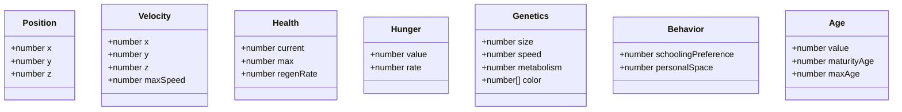
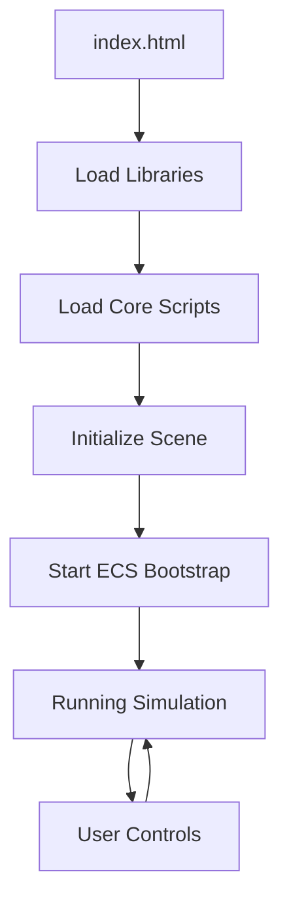
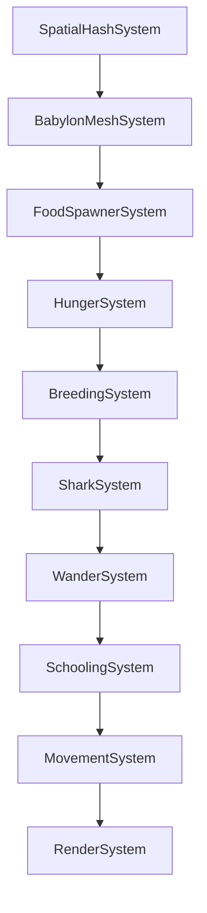
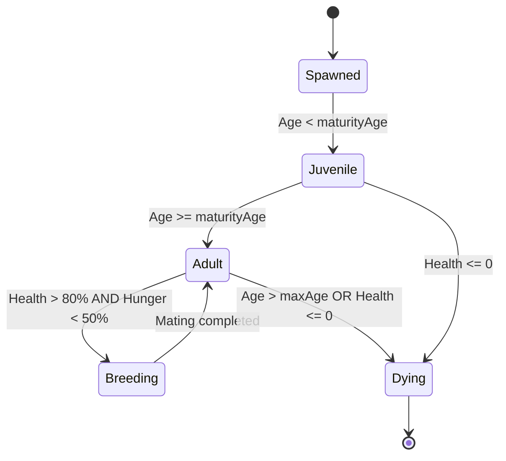
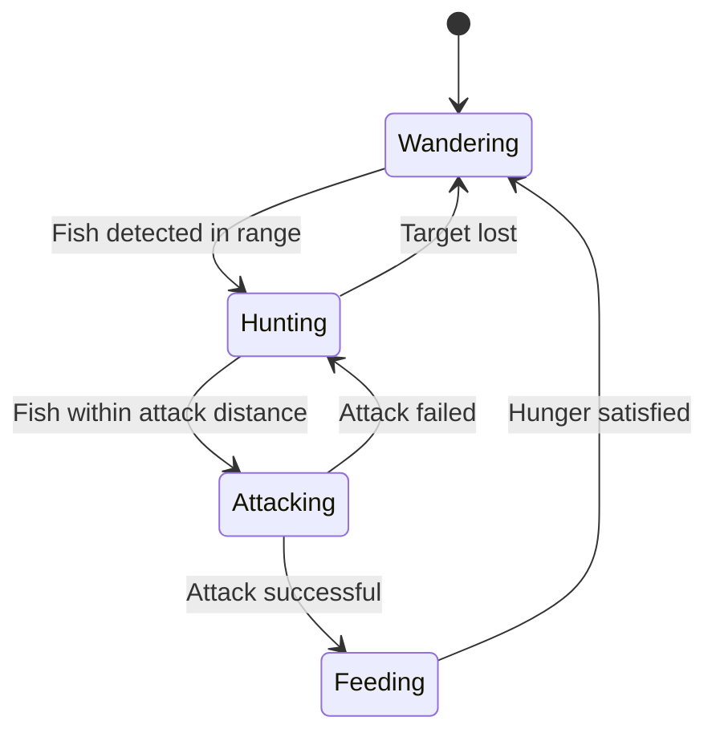

# Fish_Evo - Aquatic Life Simulation Specification

## Overview

Fish_Evo is a 3D aquatic ecosystem simulation that models realistic underwater life behaviors including fish schooling, predator-prey interactions, hunger systems, and environmental dynamics. Built with Babylon.js for rendering and ECSY for Entity-Component-System architecture, it provides an extensible framework for simulating complex ecological relationships in an immersive underwater environment.

**Core Features:**
- Real-time 3D underwater environment rendering
- Fish schooling behavior with cohesion, separation, and alignment
- Predator-prey interactions between sharks and fish
- Dynamic food spawning and consumption systems
- Day-night cycles affecting behavior patterns
- Genetic system for evolutionary traits
- Breeding and lifecycle management
- Spatial optimization for performance

## Technology Stack & Dependencies

**Core Rendering & Simulation:**
- **Babylon.js** - 3D engine for scene rendering and WebGL graphics
- **Yuka** - AI library for navigation and behavior systems
- **ECSY v0.4.3** - Entity-Component-System framework

**Development & Deployment:**
- **http-server v14.1.1** - Local development server
- **ES6+ Modules** - Modern JavaScript with import/export
- **WebGL** - Hardware-accelerated 3D graphics

**Browser Compatibility:**
- Chrome 60+, Firefox 55+, Edge 79+, Safari 12+
- WebGL 2.0 support required
- ES6 module support required

## Component Architecture

### Component Definition

The ECS architecture defines reusable data containers that entities can possess:



### Component Hierarchy

**Core Components:**
- `Position` - 3D world coordinates (x, y, z)
- `Velocity` - Movement vector and maximum speed constraints
- `Renderable` - Visual representation and scaling properties

**Biological Components:**
- `Health` - Life points with regeneration mechanics
- `Age` - Lifecycle tracking with maturity and death thresholds
- `Hunger` - Feeding needs and consumption rates
- `Genetics` - Inherited traits affecting behavior and appearance

**Behavioral Components:**
- `Behavior` - Social preferences and personality traits
- `PredatorState` - Hunting modes and aggression levels

**Classification Components:**
- `FishTag`, `SharkTag`, `CrabTag` - Entity type identification
- `FoodTag`, `SeaweedTag`, `CoralTag`, `DebrisTag` - Environmental object types

### Component Usage Examples

**Fish Entity Composition:**
```
Fish = Position + Velocity + Health + Age + Hunger + Behavior + Genetics + Renderable + FishTag
```

**Shark Entity Composition:**
```
Shark = Position + Velocity + Health + Age + PredatorState + Renderable + SharkTag
```

**Food Particle Composition:**
```
Food = Position + Renderable + FoodTag
```

## Routing & Navigation

**Single Page Application Structure:**
- `index.html` - Entry point with dynamic script loading
- No client-side routing (simulation runs continuously)
- Scene transitions handled through Babylon.js scene management

**Navigation Flow:**


## Styling Strategy

**CSS Approach:**
- Minimal CSS for canvas fullscreen display
- Babylon.js GUI system for in-simulation UI elements
- No external CSS frameworks (lightweight approach)

**Visual Styling:**
```css
canvas#renderCanvas {
    width: 100%;
    height: 100%;
    touch-action: none;
}
```

**3D Scene Styling:**
- Procedural material generation for entities
- Dynamic lighting with day-night cycles
- Particle systems for environmental effects
- Post-processing effects (bloom, fog)

## State Management

**ECS World State:**
- ECSY World instance manages all entity states
- Component-based data storage (no global state)
- System-driven state updates each frame

**Simulation State Flow:**


**Key State Managers:**
- `Simulation.js` - Central ECS world coordinator
- `UIManager.js` - User interface state and interactions
- `SimulationConfig.js` - Global configuration parameters

**State Persistence:**
- No persistent storage (simulation resets on reload)
- Runtime state maintained in ECS components
- Configuration stored in JavaScript objects

## API Integration Layer

**No External APIs:**
- Self-contained simulation (no backend dependencies)
- All data generated procedurally at runtime
- Configuration loaded from local JavaScript files

**Internal API Structure:**
- Entity Factories provide creation interfaces
- System queries provide data access patterns
- Component schemas define data contracts

**Factory API Examples:**
```javascript
// Fish creation with genetic variation
FishFactory.create(world, {
  position: { x: 10, y: 5, z: -20 },
  genetics: { size: 1.2, speed: 6.5 }
});

// Food spawning with lifetime
FoodFactory.create(world, {
  lifetime: 25000,
  nutritionValue: 15
});
```

## Testing Strategy

**Current Testing Status:**
- No formal testing framework implemented
- Manual testing through simulation observation
- Debug configuration available in `SimulationConfig`

**Testing Approach Recommendations:**

**Unit Testing (Recommended):**
- Component schema validation
- System logic verification  
- Factory entity creation
- Mathematical calculations (movement, genetics)

**Integration Testing (Recommended):**
- ECS system interactions
- Babylon.js scene integration
- Performance benchmarking

**Visual Testing:**
- Behavior validation through observation
- Performance profiling tools
- Debug visualization modes

**Testing Tools Integration:**
```javascript
// Debug features available
SimulationConfig.debug = {
  showNavMesh: false,
  logSpawnPositions: false, 
  showFPS: true
};
```

## System Architecture

### Core System Processing Pipeline



**System Execution Order:**
1. **SpatialHashSystem** - Builds spatial grid for efficient neighbor detection
2. **BabylonMeshSystem** - Manages 3D mesh creation and updates
3. **FoodSpawnerSystem** - Generates food particles based on time and population
4. **HungerSystem** - Updates hunger states and triggers feeding behaviors
5. **BreedingSystem** - Handles reproduction and offspring generation
6. **SharkSystem** - Processes predator hunting and attack behaviors
7. **WanderSystem** - Applies random movement to prevent stagnation
8. **SchoolingSystem** - Calculates flocking forces (cohesion, separation, alignment)
9. **MovementSystem** - Updates entity positions based on velocity
10. **RenderSystem** - Synchronizes visual representation with logical state

### Entity Lifecycle Management

**Fish Lifecycle:**


**Predator Behavior States:**


### Performance Optimization

**Spatial Partitioning:**
- Hash-based spatial grid for O(1) neighbor queries
- Configurable grid cell size for different entity densities
- Reduces computation from O(n²) to O(n) for proximity checks

**Rendering Optimization:**
- Instance-based mesh rendering for similar entities
- Level-of-detail (LOD) system for distant objects
- Frustum culling for off-screen entities

**Update Optimization:**
- Variable update intervals for different systems
- Entity pooling to prevent garbage collection
- Boundary constraints to prevent infinite world expansion

## Environmental Systems

### Day-Night Cycle Integration

**Lighting System:**
- Dynamic sun positioning and intensity
- Color temperature shifts (warm day → cool night)
- Ambient light adjustments affecting visibility

**Behavioral Impact:**
- Reduced food spawning during night hours
- Modified movement patterns (slower, more cautious)
- Predator activity changes

### Ecosystem Elements

**Static Environment:**
- **Coral Formations** - Provide shelter and navigation landmarks
- **Seaweed Beds** - Create movement obstacles and hiding spots
- **Ocean Debris** - Environmental variety and potential food sources
- **Landscape Terrain** - Ocean floor topology with elevation changes

**Dynamic Environment:**
- **Food Particles** - Spawned based on time of day and population density
- **Water Currents** - Subtle movement influences (future enhancement)
- **Temperature Zones** - Affect metabolic rates (future enhancement)

## Configuration Management

### Simulation Parameters

**Entity Configuration:**
```javascript
entities: {
  fish: {
    count: 30,
    maxSpeed: 8,
    schoolingDistance: 2,
    updateInterval: 2
  },
  crabs: {
    count: 8,
    maxSpeed: 2,
    neighborhoodRadius: 5
  }
}
```

**Environmental Settings:**
```javascript
world: {
  bounds: {
    minX: -50, maxX: 50,
    minY: 0, maxY: 30,
    minZ: -50, maxZ: 50
  }
},
food: {
  maxParticles: 50,
  spawnInterval: 1000,
  daySpawnRate: 15,
  nightSpawnRate: 5
}
```

**Graphics Configuration:**
```javascript
graphics: {
  shadows: { enabled: true, resolution: 1024 },
  postProcessing: { bloomEnabled: true },
  fog: { dayDensity: 0.02, nightDensity: 0.03 }
}
```