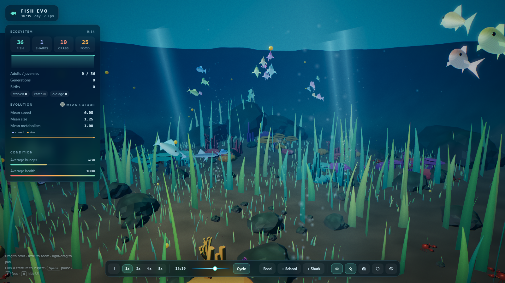

# Fish Evo



An evolving underwater ecosystem. Schools of fish forage, breed and pass their genes to the next generation while a shark hunts them and crabs scuttle across a procedural reef. Everything is generated in code: no external assets, no CDN, runs offline.

Built with [Babylon.js](https://www.babylonjs.com/) for rendering and [ECSY](https://ecsy.io/) for the simulation, bundled with Vite and TypeScript.

## Run it

```bash
npm install
npm run dev        # http://localhost:8090
npm run build      # typecheck + production bundle in build/
npm run preview    # serve the production bundle
```

## Using it

| Input | Action |
| --- | --- |
| Drag / scroll / right-drag | Orbit, zoom, pan (the camera slowly drifts when idle) |
| Click a creature | Inspect it: health, hunger, age and its genes. **Follow** or **Focus** the camera on it |
| `Space` | Pause |
| `1` `2` `3` `4` | 1x / 2x / 4x / 8x simulation speed |
| `F` | Drop food where the camera is looking |
| `H` | Hide the interface (screenshot mode) |
| `Esc` | Close the inspector |

The dock at the bottom also has a time-of-day slider, buttons to add a school or a shark, a screenshot button, an effects toggle for slower GPUs, and a restart button.

The **Ecosystem** panel tracks population, births and causes of death. The **Evolution** panel shows how the population's mean speed, size and metabolism have drifted from where they started, so you can watch natural selection happen.

## How the ecosystem works

- **Fish** school (separation, alignment, cohesion), wander, seek food when hungry and flee from sharks. Hunger drains faster for fast, high-metabolism fish. Starving fish lose health and die.
- **Breeding.** Well-fed adults that meet produce a child whose size, speed, metabolism and colour are a blend of both parents plus a small mutation (occasionally a large one). Traits are clamped to sane ranges.
- **Selection pressure.** Food is limited and sinks to the seabed, then dissolves. Big, fast, hungry fish need more of it. Slow fish get caught. Over a few generations the population shifts.
- **Sharks** chase fish and kill them on contact, then stay full for a while (much longer when prey is scarce), which keeps the predator from wiping everyone out.
- **Crabs** wander the seabed, resting now and then.
- **Day and night** change the light, the fog and how much food falls.

Left alone, the population cycles between boom and bust around the food supply. Add more sharks or cut the food to see it change.

## Tuning

Edit [src/config/simulation_config.ts](src/config/simulation_config.ts) for starting populations, food supply and world bounds. It is also exposed as `window.SimulationConfig`, and the running app is available as `window.fishEvo` (`{ scene, simulation, ui }`) from the browser console. Set `debug.logging` to `true` for verbose simulation logs.

## Code map

```
src/
  main.ts                 boot + loading screen
  config/                 tunable simulation settings
  core/
    Scene.ts              engine, post-processing, builds the world
    Camera.ts             orbit camera constrained to the water column
    Simulation.ts         ECSY world, fixed-step driver, spawn/reset actions
    stats.ts              live population stats read by the UI
  ecs/
    components/           Position, Velocity, Genetics, Hunger, Health, ...
    entities/             Fish / Shark / Crab / Food factories
    systems/              Movement, Schooling, Flee, Shark, Breeding, ...
  environment/            seabed, caustics, kelp, coral, rocks, water, day/night
  render/                 creature shader, model library, shared lighting/fog uniforms
  models/                 procedural fish, shark, crab and food meshes
  ui/                     HUD, inspector, charts, styles
```

A few details worth knowing:

- The seabed height is an analytic function (`terrainHeight`), shared by the mesh, the kelp, and the simulation. Fish, crabs and food use it directly instead of raycasting.
- Fish and sharks are single instanced meshes with a custom shader. The tail ripple, per-fish colour, hunger throb and eating flash all run on the GPU.
- The simulation runs in fixed sub-steps (see `maxStepMs`), so speeding up time stays stable.
- `tsc` is only used for typechecking (`npm run typecheck`); Vite does the bundling.
